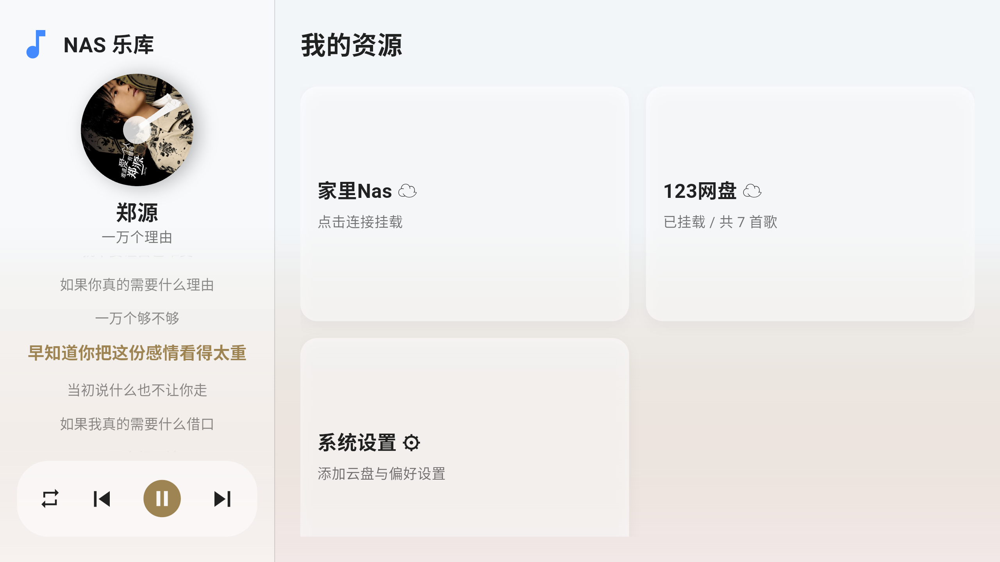
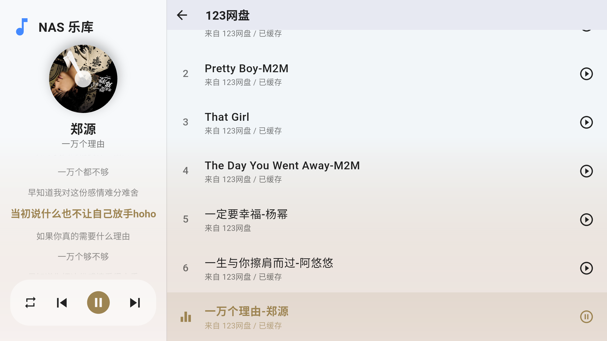
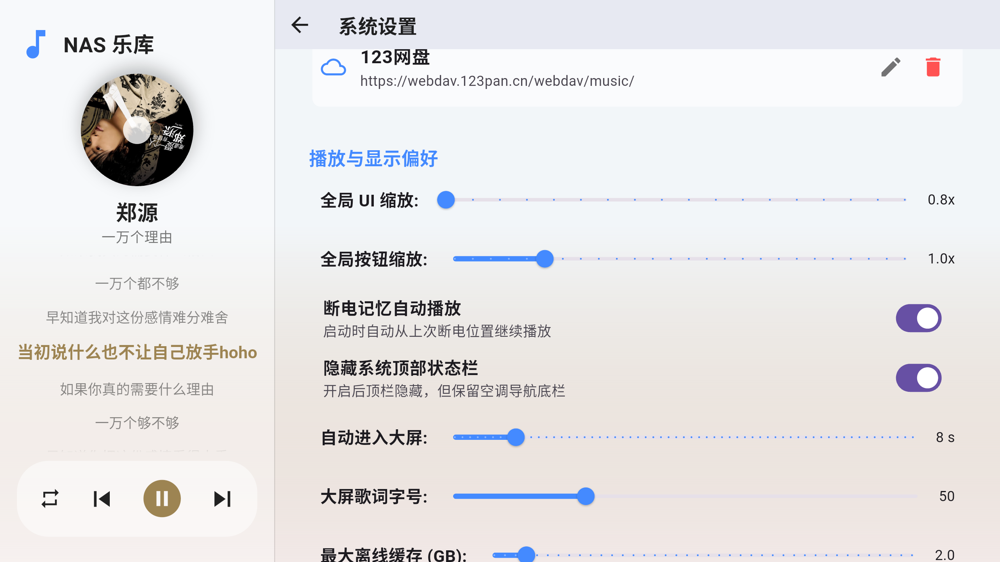
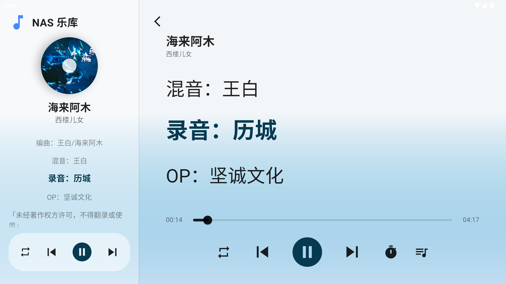

# nas_car_player

A new Flutter project.

## 本地构建配置

公共源码不含接口凭据。需要接入自有服务时，在项目根目录创建 `.local-build-defines.json`，填入需要的 `LASTFM_API_KEY`、`COVER_PROXY_TOKEN`，也可用 `COVER_PROXY_URL` 和 `LYRIC_TRANSLATION_API_URL` 指定自有服务地址。`build_apk.bat` 会读取此文件，手动运行 Flutter 时传入 `--dart-define-from-file=.local-build-defines.json`。不要提交此文件，也不要在客户端配置仅供服务端使用的密钥。

没有项目专用 `android/signing/player.keystore` 时，构建会使用本机 Android 调试签名。发布可覆盖现有安装的升级包时，必须使用原签名；`publish_update.ps1` 会验证签名。服务端配置使用 `cover_api/config.example.php` 作为模板。

## 播放队列与歌词同步

顺序播放使用 NAS 歌单的副本；随机播放先打乱一次，再让上一首、下一首和自动切歌共用这份固定队列。一轮播完才回到队列开头，手动点歌只定位到队列中的对应歌曲，不重新洗牌。切换播放模式会重新生成对应顺序，单曲循环仅影响自动切歌。随机顺序按乐库保存在本地，重启可恢复；NAS 同步保留已有歌曲的相对顺序，新歌追加，已删除的歌移出。网络临时失败不重排后台播放队列。

英文逐行翻译只补充原文行的文字，保留原始毫秒时间轴。译文返回或歌词来源更新时，取消旧布局的滚动定位；同一时间轴复用歌词行标识，并从播放器读取当前进度重新对齐。后台位置定时器仍暂停，不为歌词同步增加轮询。

## 尝试音流 箭头音乐等都对车机优化不足，干脆自己用AI撸了一个，车机webdav

